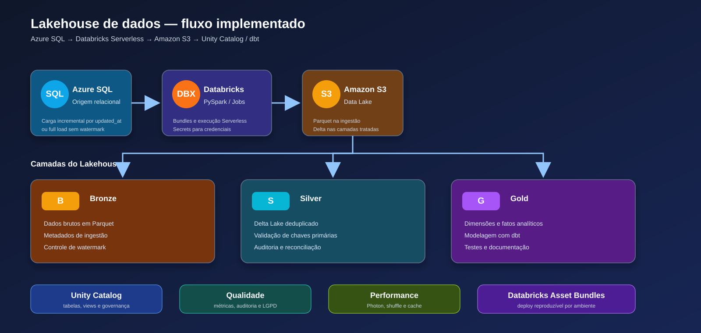

# Projeto Azure SQL + Databricks Lakehouse

Projeto de engenharia de dados construído de ponta a ponta para demonstrar ingestão, processamento, qualidade, governança, modelagem analítica e implantação com Databricks.



## Visão geral

O fluxo atual extrai dados de um Azure SQL Database, grava a camada Bronze em Amazon S3 e transforma os dados em tabelas Delta nas camadas Silver e Gold.

O projeto foi desenvolvido no VS Code usando Databricks Asset Bundles. A execução é feita no Databricks Serverless e a modelagem analítica da camada Gold utiliza dbt.

## Arquitetura implementada

```text
Azure SQL
   │
   ▼
Databricks + PySpark
   │
   ├── Bronze: Parquet no Amazon S3
   ├── Silver: Delta Lake com qualidade e auditoria
   └── Gold: dimensões e fatos modelados com dbt
          │
          └── Unity Catalog: tabelas e views governadas
```

## Tecnologias utilizadas

- Azure SQL Database: origem relacional.
- Azure Key Vault/Databricks Secrets: armazenamento de credenciais.
- Databricks Serverless: processamento Spark, Jobs e Unity Catalog.
- PySpark: ingestão, transformação e validações.
- Amazon S3: armazenamento do Data Lake.
- Parquet: formato da camada Bronze.
- Delta Lake: formato das camadas Silver e Gold.
- dbt: modelagem analítica e testes da camada Gold.
- Databricks Asset Bundles: implantação como código.
- Pytest: testes locais da aplicação e dos planos de ingestão.

Kinesis será adicionado em uma etapa posterior como fluxo de streaming separado do pipeline batch.

## Camadas de dados

### Bronze

Localização padrão:

```text
s3://lakehouse-prj-db-kafka/lakehouse/bronze/azure_sql/dbo/<tabela>/
```

Características:

- Dados extraídos do Azure SQL em Parquet.
- Colunas técnicas `_ingested_at`, `_source_schema`, `_source_table` e `_load_mode`.
- Carga incremental quando a tabela possui `updated_at`.
- Carga full para tabelas sem coluna de controle incremental.
- Watermark persistido no caminho de controle:

```text
s3://lakehouse-prj-db-kafka/lakehouse/control/bronze_watermarks_v2/
```

### Silver

Localização padrão:

```text
s3://lakehouse-prj-db-kafka/lakehouse/silver/azure_sql/dbo/<tabela>/
```

Características:

- Leitura dos arquivos Parquet da Bronze.
- Conversão para Delta Lake.
- Remoção de registros com chave primária nula.
- Deduplicação por chave primária.
- Reconciliação entre quantidade lida na Bronze e quantidade gravada na Silver.
- Registro de auditoria e qualidade por execução.

### Gold

As tabelas analíticas são criadas no catálogo `main`, schema `gold`, por meio do dbt:

- `dim_product`
- `dim_category`
- `dim_brand`
- `dim_sales_channel`
- `fct_sales_daily`

Os testes incluem unicidade, valores não nulos e relacionamentos entre dimensões e fatos.

## Qualidade e auditoria

O pipeline registra métricas como:

- quantidade de linhas lidas na Bronze;
- quantidade de linhas gravadas na Silver;
- registros com chave primária nula;
- quantidade de registros removidos;
- status da execução;
- timestamp de processamento;
- watermark utilizado na carga incremental.

Esses registros permitem consultar reconciliação, histórico de execução e falhas de qualidade sem depender apenas dos logs do Job.

## Governança e LGPD

O projeto possui views governadas no Unity Catalog para consumo analítico. Dados sensíveis, como CPF, CNPJ, e-mail, telefone, endereço detalhado e salário bruto, não são publicados nas views de consumo.

Essa implementação representa minimização de dados para o ambiente de estudo. Em um ambiente corporativo, as views devem ser complementadas por grupos, grants, políticas de acesso por linha/coluna, mascaramento e integração com o provedor de identidade da organização.

## Performance avaliada

Foi criado um notebook de baseline para observar:

- quantidade de partições de entrada;
- quantidade de registros;
- plano físico da transformação;
- uso de Photon;
- operações de `groupBy` e shuffle;
- comportamento de cache controlado;
- limitações do Serverless, como configurações Spark gerenciadas e ausência de RDD.

O código utiliza APIs de DataFrame compatíveis com Serverless. Configurações que não estão disponíveis nesse ambiente são tratadas sem interromper a execução.

## Jobs principais

Os Jobs são definidos em [databricks.yml](databricks.yml):

- teste de conexão Azure SQL → S3;
- ingestão Bronze;
- ingestão Bronze das tabelas configuradas;
- processamento Silver;
- registro de tabelas externas no Unity Catalog;
- execução dos modelos dbt Gold;
- monitoramento e qualidade;
- baseline de performance.

O pipeline Silver/Gold possui execução diária e `max_concurrent_runs: 1` para impedir sobreposição de execuções.

## Estrutura do projeto

```text
config/                 Configurações de conexão
discover/               Descoberta do catálogo e plano de ingestão
notebooks/              Ingestão, Silver, monitoramento e performance
streaming/              Produtores e consumidores de eventos Kinesis
dbt/                    Modelos, testes e configuração dbt
sql/                    Scripts de registro e governança
tests/                  Testes locais com Pytest
artifacts/              Catálogos e planos gerados durante a descoberta
docs/                   Diagramas e documentação visual
databricks.yml          Definição dos Jobs e do Bundle
```

## Execução local

Ative o ambiente virtual e execute os testes:

```powershell
pytest
```

Para validar o Bundle usando o perfil configurado:

```powershell
databricks bundle validate --target dev --profile EstudosToken
```

Para publicar ou atualizar os Jobs no Workspace:

```powershell
databricks bundle deploy --target dev --profile EstudosToken
```

Para executar a modelagem Gold localmente com dbt:

```powershell
Set-Location dbt
dbt deps
dbt build --select +fct_sales_daily
```

Credenciais e tokens não devem ser versionados. O arquivo `.env` é local e está excluído do Bundle; utilize `.env.example` como referência.

## Próxima etapa

A próxima evolução será adicionar Kinesis com Structured Streaming, checkpoint e carga incremental na Bronze. O fluxo Kinesis será mantido separado do fluxo batch para permitir operação, monitoramento e reprocessamento independentes.
